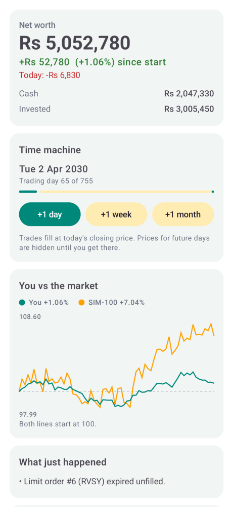
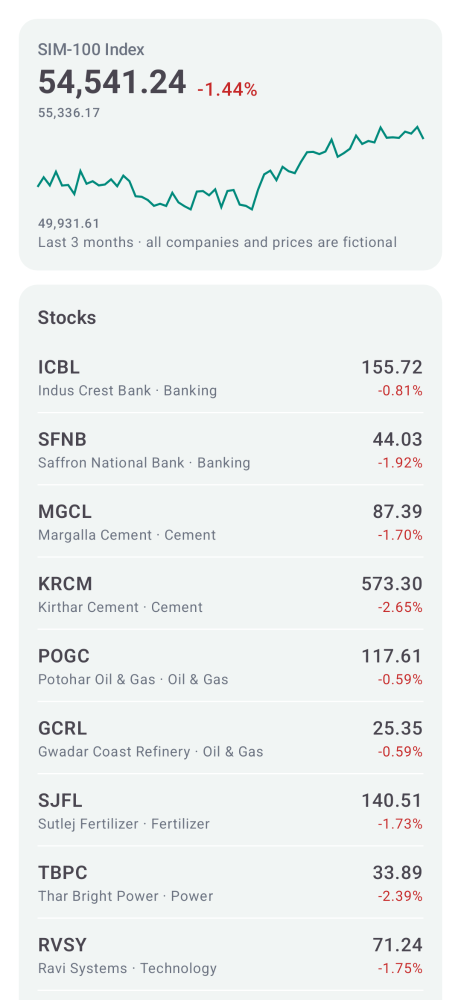
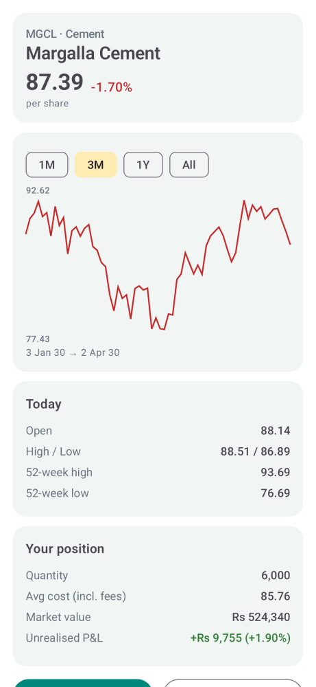
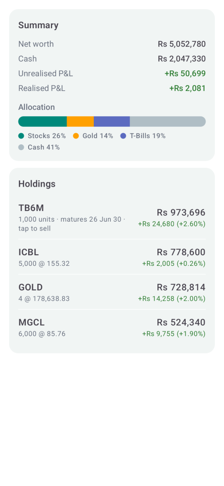
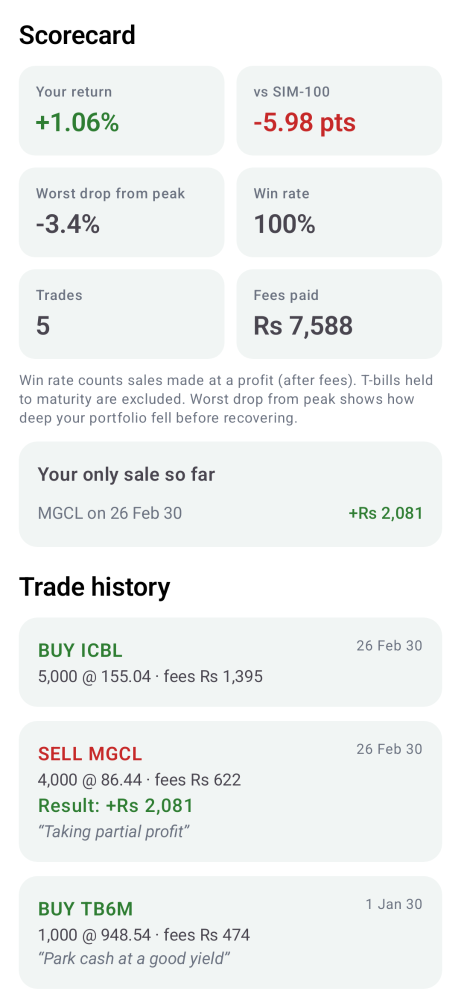

# TradeSim PK

An Android app for practising trading on a **simulated Pakistani-style market**.
You start with virtual cash, then buy and sell stocks, gold and T-bills while moving
through ~3 years of market history one day, week or month at a time.

> All companies, prices, the SIM-100 index, gold prices, T-bill yields and fees are **fictional**,
> generated by the app for practice. Not investment advice.

| Home | Market | Stock | Portfolio | Journal |
|---|---|---|---|---|
|  |  |  |  |  |

## What you can do (v0.1 MVP)

- **Starting capital**: Rs 1M, 5M or 10M of virtual cash.
- **Three scenarios**: *Full journey* (all ~3 years), *Turbulence ahead* (start just before a sell-off), *After the fall* (start near the bottom).
- **Time machine**: +1 day / +1 week / +1 month. Future prices stay hidden until you get there.
- **Assets**: 12 fictional PSX-style stocks across 9 sectors, gold (per tola), 3/6/12-month T-bills.
- **Orders**: market orders (at today's close) and limit orders (open for 20 trading days) for stocks and gold.
- **Realistic friction** (illustrative): brokerage + levies on stocks, dealer spread on gold, a small fee on T-bills, ±7.5% daily price limit.
- **T-bills**: buy at a discount, get Rs 1,000 per unit at maturity; resale value moves with yields.
- **Journal**: record *why* you made each trade, then review it against the result.
- **Scorecard**: return vs the SIM-100 index, worst drop from peak, win rate, fees paid, best and worst sale.
- **Play with friends**: everyone who enters the same **market number** and scenario gets the same price history, so you can compare results.
- Saves automatically on the phone. No account or internet needed.

## Install on an Android phone

1. Get `app-debug.apk` (built with `./gradlew assembleDebug`, output in `app/build/outputs/apk/debug/`).
2. Copy it to the phone and tap it. Android will ask you to allow installing from that source (Files app / browser); allow it.
3. Requires Android 8.0 or newer.

## Build it yourself

Requirements: JDK 17+ and the Android SDK (or just Android Studio).

```bash
./gradlew testDebugUnitTest   # engine unit tests
./gradlew assembleDebug       # builds the APK
```

## Project layout

```
app/src/main/java/pk/tradesim/
  data/MarketData.kt   simulated market generator (prices, index, gold, T-bill yields)
  data/GameStore.kt    save/load the game as JSON
  engine/Engine.kt     orders, fees, limit fills, T-bill maturity, time machine, scorecard
  ui/                  Jetpack Compose screens (Home, Market, Instrument, Portfolio, Journal, New game)
app/src/test/          engine unit tests
```

## Not modelled yet

Capital gains tax, dividends, settlement delays (T+1), short selling, margin trading, mutual funds, PIBs and real market data.
The fees and rules are simplified on purpose; real PSX, broker and tax rules differ and change over time.

## Possible next steps

- Challenges (e.g. "beat the index with no sector above 30%")
- Learning cards that explain what just happened
- Dividends and capital gains tax
- Mutual funds and PIBs
- Shared leaderboard for friends
- Real historical data (once a permitted source is confirmed)

## About this repo

he there..this is my very first attempt at programming.. i aim to be able to develop a few apps that i have in mind.
